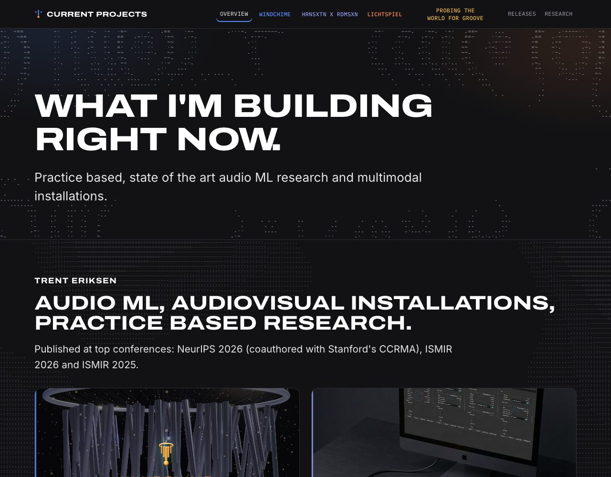
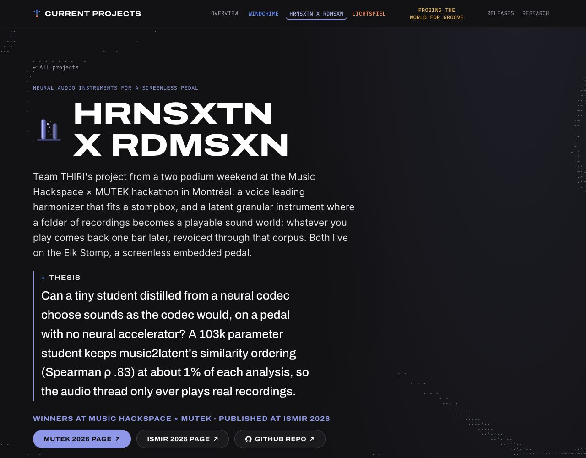

# Current Projects

**Trent Eriksen** · practice based, state of the art audio ML research and multimodal installations<br>
A public record of how four projects are built: Windchime, HRNSXTN x RDMSXN, Lichtspiel and Probing the World for Groove

[](https://grashopr-888.github.io/current-projects/)
[](https://neurips.cc/virtual/2026/loc/sydney/160685)
[](https://ismir2026program.ismir.net/lbd_679.html)
[](https://ismir2025program.ismir.net/lbd_456.html)
[](https://github.com/Grashopr-888/current-projects/actions/workflows/ci.yml)
[](https://github.com/Grashopr-888/current-projects/actions/workflows/deploy.yml)

<p align="center"><a href="https://grashopr-888.github.io/current-projects/"></a></p>

| Project                                                                                          | What                                                                                             | Published                                                             | Public code                                                                                                                                                                                                        |
| ------------------------------------------------------------------------------------------------ | ------------------------------------------------------------------------------------------------ | --------------------------------------------------------------------- | ------------------------------------------------------------------------------------------------------------------------------------------------------------------------------------------------------------------ |
| [Windchime](https://grashopr-888.github.io/current-projects/projects/windchime/)                 | voice conditioned audiovisual installation: audio language models retrieve an artist's own stems | NeurIPS 2026 Creative AI Track; shown at Gray Area, San Francisco     | [ALM audit notebook](https://github.com/Grashopr-888/NeurIPS2026_CreativeAI)                                                                                                                                       |
| [HRNSXTN x RDMSXN](https://grashopr-888.github.io/current-projects/projects/hrnsxtn/)            | neural audio instruments on a screenless pedal: a distilled codec student on the Elk Stomp       | ISMIR 2026 Late-Breaking Demo; 1st and 2nd at Music Hackspace × MUTEK | [paper, code, board logs](https://github.com/Grashopr-888/ISMIR_LBD_2026_submission)                                                                                                                               |
| [Lichtspiel](https://grashopr-888.github.io/current-projects/projects/lichtspiel/)               | live audiovisual instrument for Ableton: LLM written p5.js scenes behind a five gate verifier    | built at Berklee's AIMS 2026 hackathon                                | private                                                                                                                                                                                                            |
| [Probing the World for Groove](https://grashopr-888.github.io/current-projects/projects/groove/) | MSc thesis: frozen PaSST probed against a drum specific CNN                                      | ISMIR 2025 Late-Breaking Demo; Leiden University                      | [notebooks, thesis, paper](https://github.com/Grashopr-888/A-comparative-study-of-Transfer-Learning-for-Drum-audio-Style-Classification-) · [history](https://github.com/Grashopr-888/drum-style-thesis-notebooks) |

<p align="center"><a href="https://grashopr-888.github.io/current-projects/projects/hrnsxtn/"></a></p>

This repository is the site's source. It shows technical product management and product engineering practice
(discovery, decisions, roadmap, releases, incidents, research) **without exposing the products' private source
code**. It is a **living site**: the records are updated as the work progresses, and new projects are added as they
start. Probing the World for Groove lives under `/projects/groove/` (ported from its own site; thesis assets in
`public/groove/`, data in `src/data/groove/`).

## What this is, and isn't

- **Is:** sanitized evidence: problem framing, trade-offs, roadmaps, release notes, blameless
  postmortems, research method, and outcomes.
- **Isn't:** the products' source code, their private corpora/model weights, in-progress
  academic results, or anything a reader could use to reconstruct protected work.

The rule: **expose the _why_, summarize the sensitive _how_.** See
[`docs/redaction-policy.md`](docs/redaction-policy.md).

## Stack

Astro 5 (static, prerendered) · typed content collections with build-time cross-references ·
TypeScript · self-hosted fonts (Fontsource) · minimal client JS · GitHub Actions → GitHub Pages.

## Structure

```
src/
  content.config.ts     # the typed content model (9 collections)
  content/              # the evidence, as data (projects, decisions, releases, incidents, …)
  data/snapshots/       # sanitized aggregates produced by the ingestion pipeline
  components/  layouts/  pages/  styles/  lib/
scripts/                # ingestion + redaction pipeline (see scripts/README.md)
docs/                   # content model, redaction policy, editorial guidelines, admin
.github/                # CI, Pages deploy, issue/PR templates, CODEOWNERS
```

## Local development

```bash
npm install
npm run dev            # http://localhost:4321/current-projects
npm run check          # astro type-check
npm run build          # production build → dist/
npm run format         # prettier
```

## Ingesting new evidence

The pipeline pulls **sanitized** metadata from the private repos; raw pulls stay gitignored,
and only redacted aggregates are committed. See [`scripts/README.md`](scripts/README.md).

```bash
npm run ingest         # git + github metadata → src/data/snapshots/
npm run redact:check   # gate: fail if any secret/host slipped into src/content
```

## Before making anything public

Follow [`docs/publishing-checklist.md`](docs/publishing-checklist.md). At minimum:
`npm run redact:check` is clean, and a human has read every content change for sanitization.

## Documentation

- [Content model](docs/content-model.md): the nine collections, their fields, and where each renders.
- [Redaction policy](docs/redaction-policy.md): what's public, what's private, and why.
- [Editorial guidelines](docs/editorial-guidelines.md): register, structure and style rules.
- [Admin](docs/admin.md): branch protection, Pages setup, private→public rollout.

## License

Site code is MIT (see `LICENSE`). The **content** (writing, diagrams, screenshots) is
&copy; the author, all rights reserved; it documents private products and is not for reuse.
